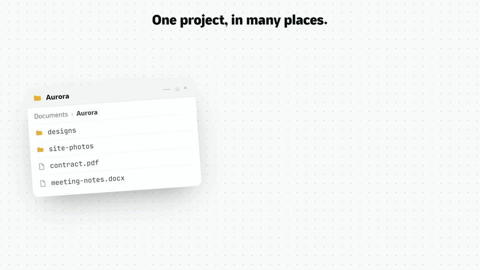

<div align="center">


# KLYPIX

### A portable project workspace with a shared brain.

**Every project gets a brain.**

*One project. One shared understanding.* · Windows · English & العربية

**[Download for Windows](https://github.com/dahshanlabs/KLYPIX/releases/latest)** · [klypix.com](https://klypix.com) · auto-updating

<br>



**▶ [Watch the 1-minute film (with sound)](https://klypix.com/media/films/homeflow-v2-16x9-en.mp4)** · [Full tour, 4 min](https://klypix.com/media/films/tour-16x9-en.mp4) · [For coding teams, 40 s](https://klypix.com/media/films/sessions-16x9-en.mp4)

**For developers:** [klypix-mcp](https://github.com/dahshanlabs/klypix-mcp), the open MCP server and hooks · [KLYPIX for Claude](https://github.com/dahshanlabs/klypix-plugin), the Claude plugin · [KLYPIX network](https://github.com/dahshanlabs/klypix-network), for teammates on other computers · [klypix.com/developers](https://klypix.com/developers)

</div>

---

KLYPIX keeps a project's files, spatial context, evidence, decisions, corrections, and open questions together in a workspace that both people and supported AI tools can inspect.

## One product, two first-class workflows

### The project workspace

A `.klypix` workspace can carry the actual bytes of files, images, and whole folder trees alongside notes, links, typed relationships, and the layout of the space. Move the original files and the workspace still works.

- Drop files or a complete nested folder into a space.
- Work with notes, images, file previews, URL cards, `[[wikilinks]]`, and eight typed arrow relationships.
- Open Obsidian `.canvas` files directly.
- Export to Markdown or JSON Canvas 1.0 with embedded assets extracted alongside.
- Capture from Windows through the remappable `Alt+Space` overlay, command palette, selected-text actions, clipboard history, dictation, and screen-aware tools.

Embedded folder cards have deliberate limits: 200 MB per file and 1 GB per folder card. Cloud sharing has a separate 50 MB limit per space.

### The repository project brain

A software repository can keep its source in Git and carry project understanding in a versioned `brain.klypix` beside the code. Coding-agent sessions can read task-relevant context at task start and record durable decisions, findings, corrections, and open questions back into the same inspectable file.

KLYPIX coordinates independently running agents; it does **not** create, launch, supervise, route, or execute them.

On one machine, `brain_sync` can also show active connected sessions, their declared intent, and exact file paths that overlap. These are advisory warnings: KLYPIX surfaces the overlap but never blocks an edit. The committed `brain.klypix` file is what travels between machines through Git.

**New: teammates on other computers.** With [KLYPIX network](https://klypix.com/network) installed on each computer (klypix-mcp 1.106.0 or later), `brain_sync` also lists agent sessions on teammates' computers in the same project and gives the same overlap warning, and `brain_message` can send them a note. Without it, live presence and overlap warnings stay on one machine and OS user.


## Open brain infrastructure

The `.klypix` format parser, MCP server, and hooks are Apache-2.0 and work without the proprietary desktop app.

Run this inside a repository to install the engine, wire Claude Code's lifecycle hooks, and connect Codex for that project:

```bash
npx klypix-mcp install
```

For project-native MCP/rules files used by additional supported hosts:

```bash
npx klypix-mcp link
```

Host capabilities differ. Claude Code has automatic lifecycle injection and capture; Codex gets native MCP and the Context Gateway, with optional approved lifecycle hooks; other MCP hosts depend on their rules and explicit tool calls. The complete compatibility matrix and commands live in [klypix-mcp](https://github.com/dahshanlabs/klypix-mcp).

For Git repositories, an optional merge driver can be registered once per machine:

```bash
npx klypix-mcp git-driver install
```

Once registered, Git hands `.klypix` merges to the KLYPIX engine. An unregistered machine falls back to a normal Git conflict rather than silently pretending the binary merged.

## What ships in the Windows app

- **Spatial project workspace** — files, folders, previews, notes, links, typed relationships, and project-brain lenses.
- **Capture and action layer** — overlay, command palette, text actions, clipboard history, screen capture, voice input, and document workflows.
- **Local document AI** — local indexing and optional on-device answer models; cloud AI remains available through your configured provider.
- **KLYPIX Drive and Share-to-Self** — a Drive portal plus encrypted phone-to-PC delivery for paired devices.
- **Cloud sharing and collaboration** — spaces encrypted on the device before upload, web viewing, live presence, cursors, chat, and collaborator controls, with the privacy boundaries below.
- **English and Arabic** — Arabic includes RTL layout; a few newer panels remain English-only.

## Privacy, honestly stated

- A space reaches KLYPIX cloud storage only when you choose to share it. The file is encrypted on the device before upload.
- This is not a blanket end-to-end-encryption claim: space titles are stored unencrypted, the live operation log is readable by the service, and the server holds the key for email-invited collaborators.
- What you share from your phone to KLYPIX is encrypted on the phone before upload, and the key stays on your devices. The server keeps what it needs to deliver it (account, item type, destination space, times, sending device) and keyed word fingerprints for phone search, which it can match but not read. Items sent to a space shared by email invitation are readable to KLYPIX, because KLYPIX holds that space's key.
- The local file index and local answer path run on the device. Requests sent to a configured cloud model go to that provider. Screen pixels are sent only when a screen-aware feature is used and its separate permission has been granted.

## Install

Download the current installer from [GitHub Releases](https://github.com/dahshanlabs/KLYPIX/releases/latest). KLYPIX currently ships as a Windows 10/11 x64 per-user application and updates through staged releases from this repository.

## Boundaries worth knowing

- The desktop app is Windows-only today.
- This repository is release-only. The desktop application source is proprietary; the format, MCP server, and hooks are open at [dahshanlabs/klypix-mcp](https://github.com/dahshanlabs/klypix-mcp).
- Live agent presence, one-time session messages, and overlap warnings cross machines only with [KLYPIX network](https://klypix.com/network) installed on each computer; without it they stay on one machine. Read receipts and result reconciliation stay local either way.
- Overlap detection matches the exact paths sessions declare and is advisory.
- KLYPIX is a coordination and shared-understanding layer, not an agent launcher, runtime, workflow engine, model router, or replacement for Git.

---

<div align="center">

© Dahshan Labs · [klypix.com](https://klypix.com) · [hello@klypix.com](mailto:hello@klypix.com) · [open brain infrastructure](https://github.com/dahshanlabs/klypix-mcp)

</div>
